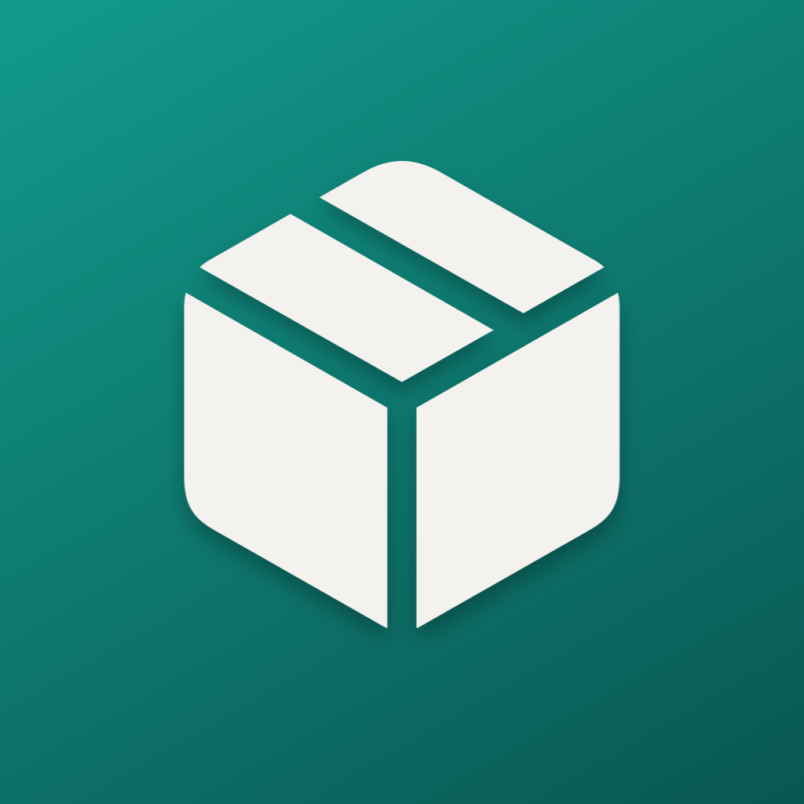
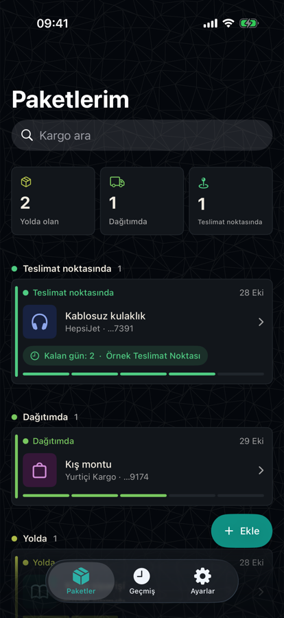
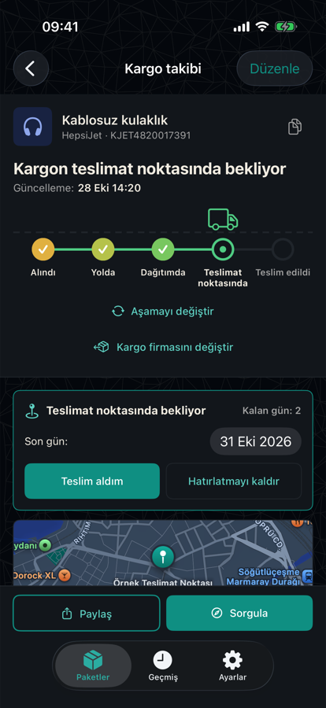
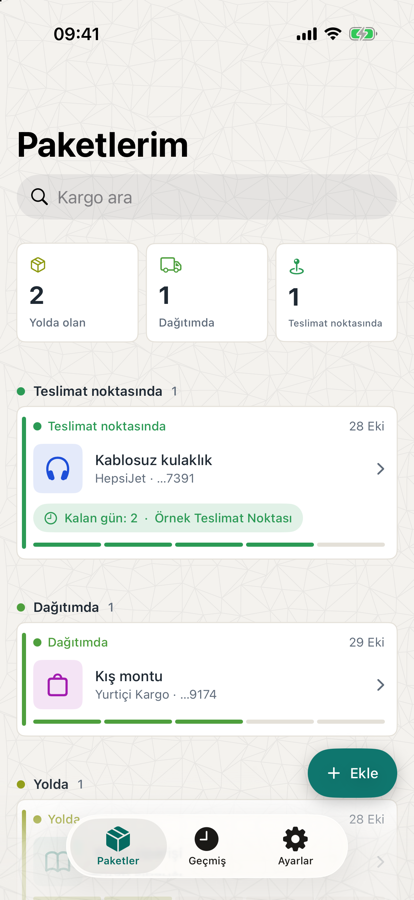

# Parcel Tracker

**A calm, private parcel tracker for iPhone, built for Turkish carriers.**
**iPhone için sade ve özel bir kargo takip uygulaması. Türkiye'deki kargo firmaları için.**

Yurtiçi · Aras · PTT · Sürat · Trendyol Express · HepsiJet · DHL · UPS · FedEx

[English](#english) · [Türkçe](#türkçe) · [Download / İndir](../../releases/latest)

  

Screenshots use sample parcels. / Ekran görüntülerinde örnek kargolar var.

---

## English

Parcel Tracker keeps all your parcels in one list and opens each carrier's own tracking page with the number already filled in. It reads the result, suggests the stage and date, and you confirm. Everything stays on your phone.

### Features

- **Five clear stages**, coloured from amber to green: Received, In transit, Out for delivery, At pickup point, Delivered. A separate red **Returned** path covers returns.
- **The carrier's own page, inside the app.** The number is typed and submitted for you. The app reads the page text and suggests the stage and its date; you tap Apply.
- **Pickup point reminders.** For parcels held at a pickup point (Hepsiburada, Trendyol and similar), you get a notification every morning until the last day. Pick the time and the number of days in Settings.
- **Pickup point on a map.** Search for it, save it, open it in Apple Maps or Google Maps.
- **Scan or import.** Scan a barcode or QR code with the camera, or read one from a photo.
- **Carrier suggestions** that match the number's format. You choose.
- **Your own look.** Label, colour and icon for each parcel. Light and dark themes.
- **An animated truck** that drives to the next stage.
- **English and Turkish**, following your phone's language.
- **Private.** Parcels are stored on your phone. No account, no analytics, no tracking.

### Carriers

Yurtiçi Kargo, Aras Kargo, PTT Kargo, Sürat Kargo, Trendyol Express, HepsiJet, DHL eCommerce (formerly MNG Kargo), Kolay Gelsin, Sendeo, KargoİST, DHL Express, UPS, FedEx, AliExpress / Cainiao, and Other (opens 17TRACK).

Carriers change their sites. When a number can't be filled in on its own, the app offers a copy button. DHL eCommerce asks for a verification code that only you can enter.

### Install

There is no App Store or TestFlight version. The app is an unsigned `.ipa` that you sign with your own Apple ID.

1. Download `ParcelTracker-1.0-unsigned.ipa` from the [latest release](../../releases/latest).
2. Install it with [Sideloadly](https://sideloadly.io) or [AltStore](https://altstore.io) and sign in with your Apple ID.
3. On the iPhone, open *Settings → General → VPN & Device Management* and trust your developer profile.

With a free Apple ID the app expires after 7 days and has to be installed again. A paid developer account extends that to a year. The app needs iOS 17 or later.

### Limits

- Status is not fetched through an API. The app reads the carrier's page and always asks you to confirm.
- Stage and date reading uses Turkish and English keywords and has only been tried on sample texts. If it misses, set the stage by hand.
- Address search uses Apple Maps data, so some pickup points may not appear.
- The `.ipa` has not been installed through Sideloadly or AltStore yet. The author runs the app from Xcode on one iPhone.

### Feedback

Open an [issue](../../issues) for bugs, carrier requests or ideas. The source code is not public.

---

## Türkçe

Parcel Tracker tüm kargolarını tek listede toplar ve her firmanın kendi takip sayfasını numara önceden yazılmış hâlde açar. Sonuç sayfasını okuyup aşamayı ve tarihi önerir, onayı sen verirsin. Her şey telefonunda kalır.

### Özellikler

- **Beş net aşama**, kehribardan yeşile renkli: Alındı, Yolda, Dağıtımda, Teslimat noktasında, Teslim edildi. İadeler için ayrı, kırmızı bir **İade edildi** yolu var.
- **Firmanın kendi sayfası, uygulamanın içinde.** Numara senin yerine yazılıp sorgulanır. Uygulama sayfa metnini okuyup aşamayı ve tarihini önerir, sen "Uygula"ya basarsın.
- **Teslimat noktası hatırlatmaları.** Hepsiburada, Trendyol gibi teslimat noktasında bekleyen kargolar için son güne kadar her sabah bildirim gelir. Saati ve gün sayısını Ayarlar'dan seçersin.
- **Teslimat noktası haritada.** Ara, kaydet, Apple Haritalar veya Google Haritalar'da aç.
- **Tara veya içe aktar.** Barkod ya da QR kodu kamerayla tara, ya da fotoğraftan oku.
- **Firma önerisi**, numaranın biçimine göre. Seçim sana kalır.
- **Kendi tarzın.** Her kargoya etiket, renk ve simge. Açık ve koyu tema.
- **Animasyonlu kamyon**, bir sonraki aşamaya doğru sürer.
- **Türkçe ve İngilizce**, telefonun diline göre.
- **Özel.** Kargolar telefonunda saklanır. Hesap, analiz ya da izleme yok.

### Firmalar

Yurtiçi Kargo, Aras Kargo, PTT Kargo, Sürat Kargo, Trendyol Express, HepsiJet, DHL eCommerce (eski adıyla MNG Kargo), Kolay Gelsin, Sendeo, KargoİST, DHL Express, UPS, FedEx, AliExpress / Cainiao ve Diğer (17TRACK'i açar).

Firmalar sitelerini değiştirebilir. Numara kendiliğinden yazılamazsa uygulama kopyala düğmesi sunar. DHL eCommerce yalnızca senin girebileceğin bir doğrulama kodu ister.

### Kurulum

App Store ya da TestFlight sürümü yok. Uygulama, kendi Apple Kimliğinle imzaladığın imzasız bir `.ipa` dosyasıdır.

1. [Son sürümden](../../releases/latest) `ParcelTracker-1.0-unsigned.ipa` dosyasını indir.
2. [Sideloadly](https://sideloadly.io) veya [AltStore](https://altstore.io) ile Apple Kimliğinle imzalayıp kur.
3. iPhone'da *Ayarlar → Genel → VPN ve Aygıt Yönetimi* bölümünden geliştirici profiline güven.

Ücretsiz Apple Kimliği ile uygulamanın süresi 7 günde dolar, yeniden kurmak gerekir. Ücretli geliştirici hesabıyla bu bir yıla çıkar. iOS 17 veya üstü gerekir.

### Sınırlar

- Durum bir API'den çekilmez. Uygulama firmanın sayfasını okur ve her zaman onayını ister.
- Aşama ve tarih okuma Türkçe ve İngilizce anahtar kelimelerle çalışır, yalnızca örnek metinlerde denendi. Kaçırırsa aşamayı elle seç.
- Adres araması Apple Haritalar verisini kullanır, bazı teslimat noktaları çıkmayabilir.
- `.ipa` henüz Sideloadly veya AltStore ile kurulup denenmedi. Geliştirici uygulamayı tek bir iPhone'da Xcode'dan çalıştırıyor.

### Geri bildirim

Hata, firma isteği ya da fikir için [issue](../../issues) aç. Kaynak kod açık değil.
